# Post-contenido — Unidad 5: Fundamentos de Java Web (Servlets y JSP)

## Información del Estudiante
* **Nombre:** Andrea Valentina Rivera Fernández
* **Código:** 1152444
* **Institución:** Universidad Francisco de Paula Santander (UFPS)
* **Carrera:** Ingeniería de Sistemas
* **Materia:** Programación Web
* **Unidad:** 5 
* **Año:** 2026

## Descripción

Repositorio del laboratorio de la Unidad 5 de Programación Web. Contiene un
único proyecto Maven Web (`gestion-tareas`) con dos partes que extienden el
mismo dominio de tareas: la Parte 1 construye el Servlet base con el ciclo
GET/POST y el patrón Post/Redirect/Get; la Parte 2 le agrega filtrado
combinado, una vista de detalle servida por un segundo Servlet y sesión para
personalización y persistencia del filtro.

**Tecnologías:** Java, Jakarta Servlet 6.0, JSP, JSTL 3.0, Maven y Apache
Tomcat 10.1.

## Parte 1 — Servlet de gestión de tareas

`TareasServlet` procesa peticiones GET (listar) y POST (agregar, eliminar),
con validación en el servidor y el patrón Post/Redirect/Get para evitar el
reenvío de formularios. Los datos se envían a la vista `tareas.jsp` mediante
`RequestDispatcher`.

## Parte 2 — Filtros, detalle y sesión

`TareasServlet` se extiende con filtrado combinado por texto, categoría y
prioridad, y con las acciones `completar` e `identificar`. Se agrega
`DetalleTareaServlet`, que lee la misma lista de tareas desde
`applicationScope` y hace forward a `detalle.jsp`. `HttpSession` guarda el
nombre del usuario identificado y el último filtro aplicado. Los estilos se
movieron a `css/estilos.css`.

## Estructura del proyecto

```
rivera-post1-u5/
├── pom.xml
├── README.md
├── img/                          (capturas de pantalla)
└── src/main/
    ├── java/com/ejemplo/
    │   ├── model/Tarea.java
    │   └── servlet/
    │       ├── TareasServlet.java
    │       └── DetalleTareaServlet.java
    └── webapp/
        ├── index.jsp
        ├── css/estilos.css
        └── WEB-INF/
            ├── web.xml
            └── views/
                ├── tareas.jsp
                └── detalle.jsp
```

## Decisiones de diseño

- **Lista de tareas como variable de instancia.** La lista es estado
  compartido de toda la aplicación: todas las peticiones deben ver las mismas
  tareas. En cambio, datos como el `titulo` leído en un POST son variables
  locales del método, porque el Servlet tiene una sola instancia compartida
  por todos los hilos y guardar datos de una petición en un campo causaría
  condiciones de carrera.
- **Post/Redirect/Get en las acciones POST.** Tras agregar, eliminar,
  completar o identificar se hace `sendRedirect` a `/tareas`, para que
  recargar la página no reenvíe el formulario. Solo el error de validación usa
  `forward`, porque debe mostrarse en la misma respuesta.
- **Filtro y usuario en HttpSession, no en el request.** El nombre del usuario
  y el último filtro deben sobrevivir a varias peticiones (navegación entre
  `/tareas` y `/tareas/detalle`). Un atributo de request se pierde al terminar
  la petición. La lista filtrada resultante sí es solo de request, porque es
  el resultado calculado para esa respuesta.
- **DetalleTareaServlet usa applicationScope.** Obtiene las tareas del
  `ServletContext`, donde `TareasServlet` las publica en `init()`, en vez de
  duplicar la lista. Para garantizar que ya estén publicadas, `TareasServlet`
  usa `loadOnStartup = 1`.
- **Forward y no redirect en el detalle.** Es una simple lectura (GET) que
  solo necesita entregar un objeto ya en memoria a una vista, sin generar una
  nueva petición del navegador ni cambiar la URL.
- **Hoja de estilos externa.** Al agregar una segunda vista (`detalle.jsp`)
  se extrajo el `<style>` embebido a `css/estilos.css`, para no duplicarlo en
  cada JSP.
- **URI de JSTL.** Se usan `jakarta.tags.core`, `jakarta.tags.functions` y
  `jakarta.tags.fmt`, las URI de JSTL 3.0 para Jakarta EE 10.

## Cómo compilar y desplegar

**Requisitos:** JDK 17 o superior, Maven 3.8+ y Apache Tomcat 10.x.

1. Clonar el repositorio:
   ```
   git clone https://github.com/Andrea-Rivera31/rivera-post1-u5.git
   ```
2. Abrir la carpeta como proyecto Maven en IntelliJ IDEA.
3. Compilar:
   ```
   mvn clean package
   ```
   Genera `target/gestion-tareas.war`.
4. Configurar Tomcat Server (Local) en el IDE, con Tomcat 10.1, y desplegar
   el artefacto `gestion-tareas:war exploded` con el contexto
   `/gestion-tareas`. Alternativa manual: copiar el `.war` a la carpeta
   `webapps` de Tomcat y ejecutar `bin/catalina.sh run`.
5. Abrir en el navegador: http://localhost:8080/gestion-tareas/tareas

## Capturas de pantalla

### Parte 1

Compilación exitosa:

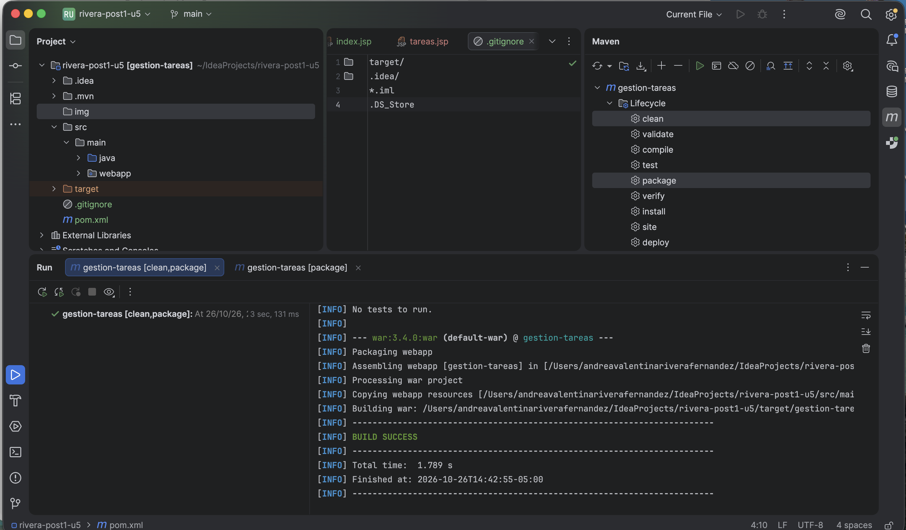

Lista inicial con 2 tareas:


Tarea agregada (la URL se mantiene en /tareas, patrón PRG):

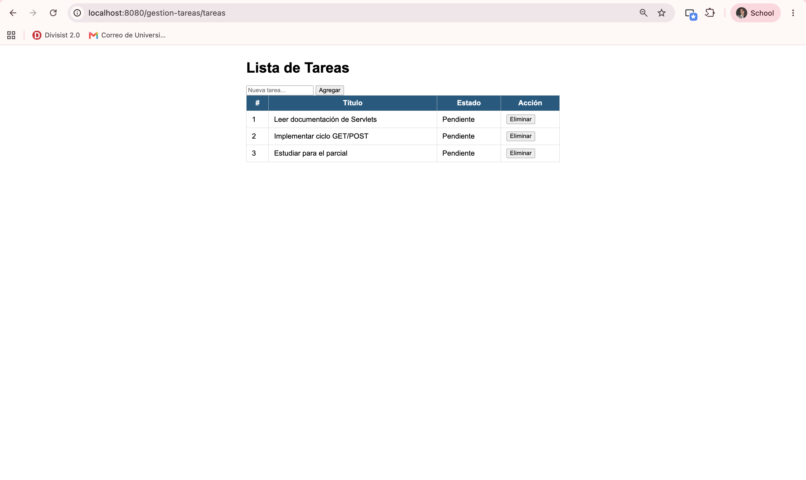

Validación del servidor con título vacío:

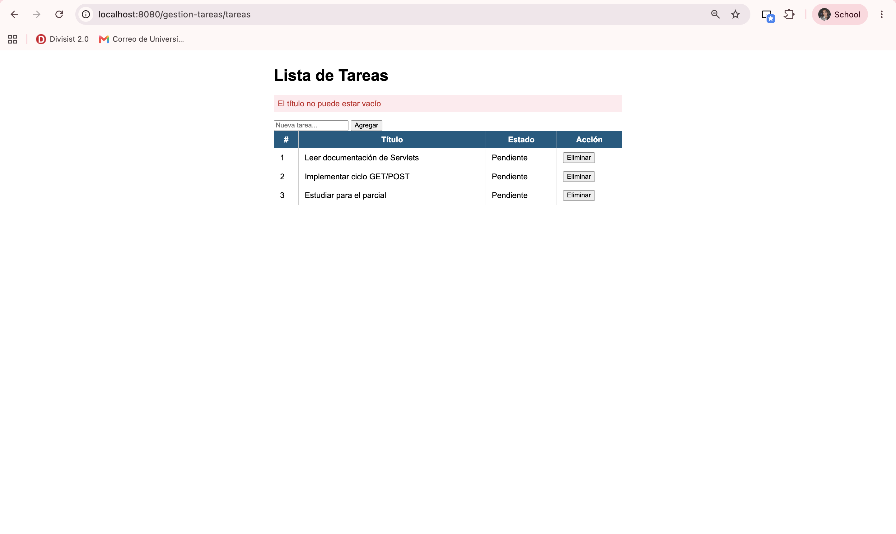

Tarea eliminada:

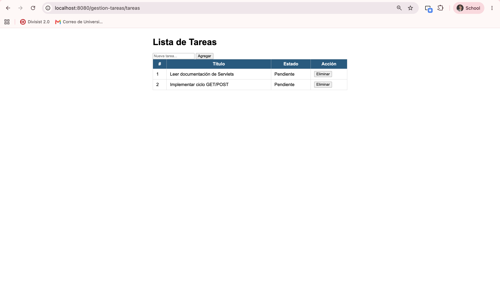

Historial de commits de la Parte 1:

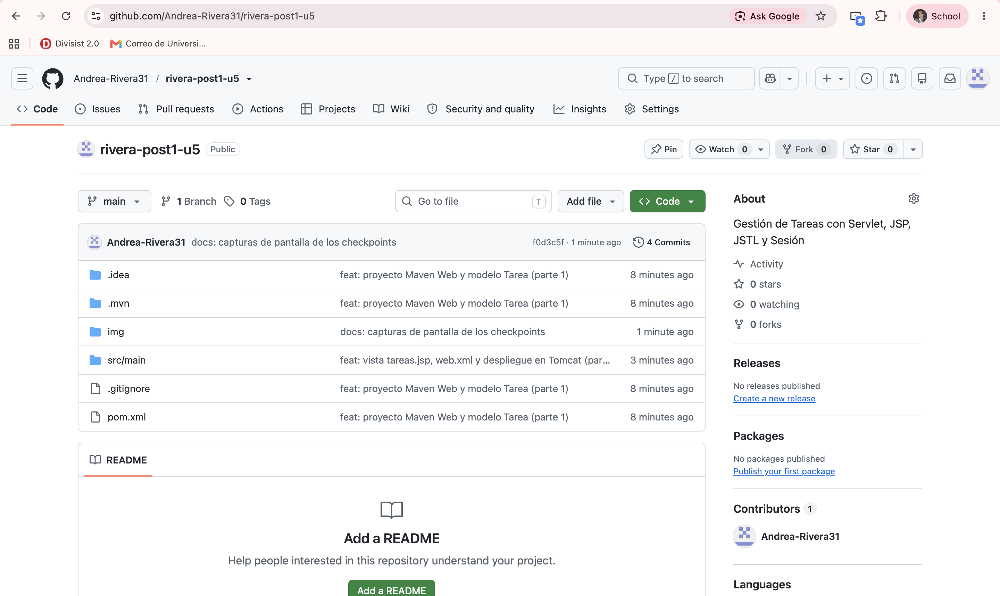

### Parte 2

Compilación exitosa:

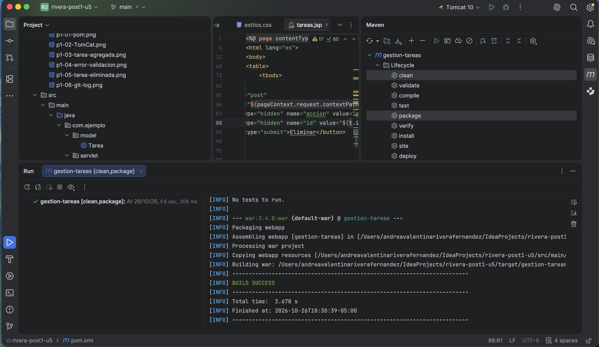

Saludo de sesión:


Lista con filtro combinado (categoría + prioridad):

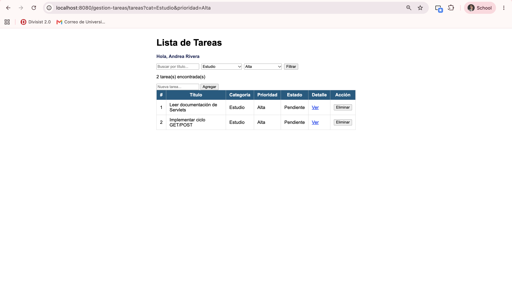

Filtro recordado en sesión (URL sin parámetros):

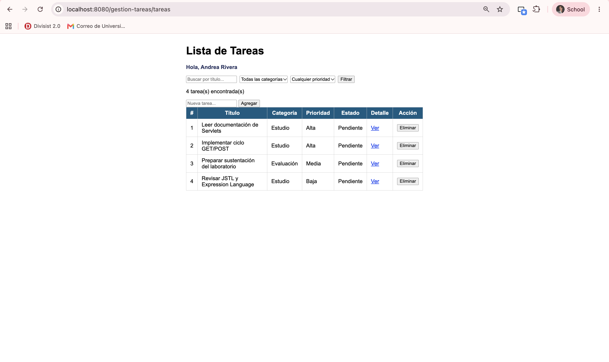

Detalle de una tarea:

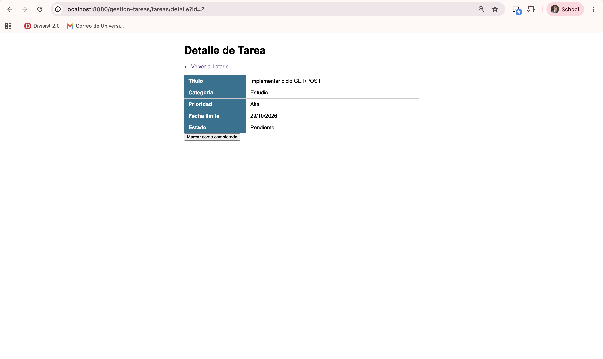

Tarea completada (tachada):

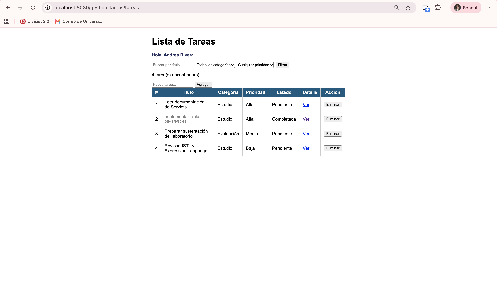

Tarea no encontrada:

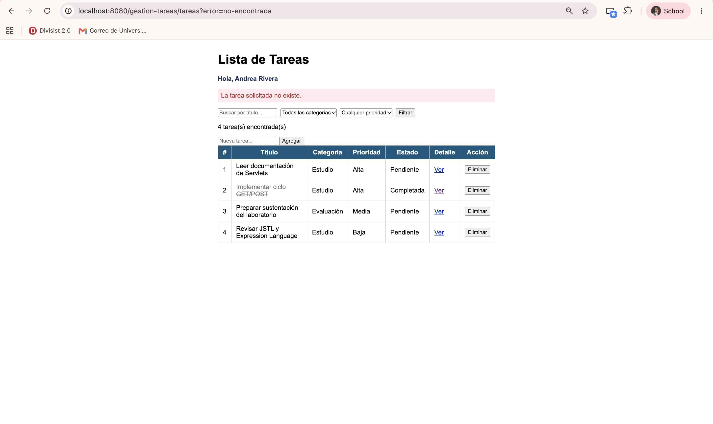